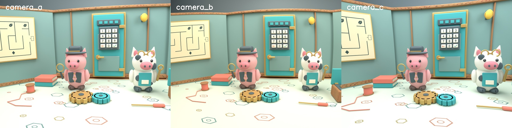

# Homework 1: calibration and image stitching with three cameras

Detective Pippa and Tinker Spot are trapped in **The Truffle Vault**. Their escape
plan involves a maze, a decoder, and a keypad. Unfortunately, the room comes in
four separate photographs, and their little pig brains cannot put the views
together. Pippa suspects there are four rooms. Spot suspects there are four exits.
Both are still inside.

Between them, they have three working neurons: one for snacks, one for saying
“oink,” and one currently on a lunch break. Four photographs are simply too much.

**Help the pigs escape!** Correct the lens distortion and stitch the photographs
into one panorama so they can finally see how the clues fit together. Please
hurry: Spot is considering eating the keypad.

Download and extract the dataset as described below, then inspect the four images
in each camera's `stitching/` directory.
Your task is to correct their lens distortion and combine them into a panorama.



Each camera also has a `calibration/` directory containing images of a ChArUco
board at different positions and orientations. Use these images and the board
specification in [board.json](board.json) to estimate that camera's parameters
before stitching.

Solving the escape-room puzzle is optional; your assessed work is the calibration
and stitching pipeline.

## Workload and assessment

Implement your methods once and reuse them. The four tasks produce:

- Calibrations for all three cameras.
- One manual two-image stitch from camera A.
- Three corrected four-image panoramas, one per camera.
- One raw four-image panorama from camera B, showing what happens without correction.
- Two short camera-B experiments: calibration on/off and RANSAC on/off.

Assessment is a conversation supported by your code, results and report. There
is no automatic grading. Treat the report as a lab notebook: record decisions,
failures, measurements and observations in your own words. Include selected
images that support your conclusions rather than a gallery of every intermediate
result.

## Dataset and software

Download [hw1-2026-data-v1.tar.gz](https://www.mimuw.edu.pl/~ciebie/hw1-2026-data-v1.tar.gz)
(about 166 MB) and its [SHA-256 checksum](hw1-2026-data-v1.tar.gz.sha256).
Save both files in your homework directory, then verify and extract the archive:

```sh
shasum -a 256 -c hw1-2026-data-v1.tar.gz.sha256
tar -xzf hw1-2026-data-v1.tar.gz
```

On Linux, `sha256sum -c hw1-2026-data-v1.tar.gz.sha256` is an alternative checksum
command. Extract only after verification reports `OK`; an archive manager can
also extract the files. The images are hosted separately from this website.

The archive creates the following structure:

```text
data/
  camera_a/
    calibration/view_01.png ... view_24.png
    stitching/view_01.png ... view_04.png
  camera_b/                 # same structure
  camera_c/                 # same structure
board.json                  # calibration-board specification
board.png                   # reference board image
dataset.json                # calibration split, image inventory and checksums
```

Each camera has 24 calibration images and four
ordered stitching views, all at 1280 × 960 pixels. [board.png](board.png) shows
the board. Calibration photographs have a synthetic workshop background; only
the printed board supplies calibration points. Its plain white border is not
an extra row of squares. Some edge views show only part of the board.

All images are synthetic. The three cameras share focal length but have different
lens distortion. Each stitching sequence uses rotation about a
fixed optical centre, with no camera translation.

Use [uv](https://docs.astral.sh/uv/) to manage your Python project. The dataset was
checked with `opencv-contrib-python==4.11.0.86`, which includes the ArUco/ChArUco
APIs. Install only one OpenCV wheel variant in your environment. NumPy and
Matplotlib are useful for the geometry and visualisations.

Use the standard OpenCV perspective model with distortion coefficients
`k1, k2, p1, p2, k3`. Library functions are allowed for calibration, undistortion,
feature detection and RANSAC. Implement the inverse warp and SVD homography
estimator in Task 2 yourself. Do not replace the pipeline with `cv2.Stitcher`.

Points are `(x, y)`; NumPy images are indexed as `image[y, x]`. State which image
each homography maps from and to. Retain the estimated camera matrix as the
undistorted output matrix, with no cropping or resizing before matching.

## Task 1 — Calibrate the cameras

For each camera:

1. Reserve calibration views **05, 12, 16 and 23** for validation, using the same
   split for all three cameras. Detect ChArUco corners in the other 20 views,
   associate their IDs with the correct board points, and estimate the camera
   matrix and five distortion coefficients. You may use a subset of those 20;
   explain the selection and any rejected images. Do not use the reserved views
   to fit or tune the intrinsic parameters, distortion or detection settings.
2. Show two representative detections: one central board and one tilted or
   partly visible board near the image boundary. Additional overlays are useful
   for debugging but need not appear in the report.
3. Report fitting reprojection RMS and plot the per-view RMS errors. Use
   `sqrt(mean(||observed - projected||²))` over corner observations, in pixels.
4. Detect the board in the four reserved views. Keep the estimated camera matrix
   and distortion fixed; estimate only each board's rotation and translation
   with `cv2.solvePnP`. Report the held-out reprojection RMS alongside the fitting
   RMS, aggregating over corners rather than averaging per-image RMS values.
   Include the held-out views in the plot with a different colour. Use the
   original calibration for stitching; do not refit it on the reserved views.
5. Undistort the four stitching views. Show an original/corrected comparison
   for each camera. Identify barrel versus pincushion distortion and rank
   its strength using edge curvature or feature displacement in these images.
   Explain how correction changes curved edges and the usable image area.

Compare the estimated intrinsics and distortion, but do not judge calibration
solely by individual coefficients or training reprojection error. Explain what
makes the board poses informative. The reserved images test calibration on new
board poses, but their poses are fitted using their observed corners: a small
residual still does not prove accuracy throughout the sensor.

Useful APIs: `cv2.aruco.CharucoBoard`, `cv2.aruco.CharucoDetector`,
`board.matchImagePoints`, `cv2.calibrateCamera`, `cv2.initUndistortRectifyMap`,
`cv2.remap`, `cv2.solvePnP`, `cv2.projectPoints`. Board dimensions are in metres.
Corner refinement is optional.

## Task 2 — Implement the geometry

### Estimate a homography with SVD

Construct the linear system from corresponding 2D points. Estimate the homography
from the right singular vector associated with the smallest singular value;
`numpy.linalg.svd` is allowed. Use at least four noncollinear correspondences.
Normalising point coordinates first is recommended for numerical stability.

Test recovery from known nonsingular homographies with both exactly four points
and an overdetermined system. Evaluate points not used for fitting. Compare
mappings rather than unnormalised matrix entries, since a homography is defined
only up to scale. Include a degenerate case and explain your method's response.

### Apply an inverse warp

For each destination pixel, apply the inverse homography, perform homogeneous
division, and sample the source image. Nearest-neighbour sampling is sufficient;
loops are acceptable. Handle out-of-bounds coordinates and return a validity
mask: a black image pixel is not necessarily an invalid pixel.

Do not delegate this function to `cv2.warpPerspective`, `cv2.remap`, or another
image-warping library function. Check simple cases such as identity and a known
translation. You will demonstrate the function on actual alignment in Task 3;
no separate arbitrary-transformation picture is required.

## Task 3 — Build one manual stitch

Use **camera_a, views 02 and 03 after undistortion**. Select at least eight
correspondences by hand, spread across the overlap, aiming for one-pixel accuracy.
Use identifiable features on the pigs, door, keypad or work mat. A point picker
such as `matplotlib.ginput` is allowed; an automatic detector must not supply the
coordinates. Save the coordinates and a numbered correspondence image.

Estimate the homography with your Task 2 SVD implementation. Report its fitting
RMS and inspect alignment at features away from your selected points. Explain
why a low fitting error does not guarantee accurate alignment everywhere.

Use your inverse warp to place the two originals on a canvas containing both.
Show alignment before blending, then combine them with a method of your choice,
such as feathering. Save `manual_camera_a.png`. Explain any remaining seams and
distinguish alignment errors from sampling or blending artifacts.

## Task 4 — Automatic stitching and two experiments

### Build the panoramas

Process all four **undistorted** views for each camera:

1. Detect ORB features, match binary descriptors between neighboring views
   01–02, 02–03 and 03–04, and filter ambiguous matches. Report your settings.
   Subpixel feature refinement is optional; state whether you use it.
2. Estimate each neighboring homography with
   `cv2.findHomography(..., cv2.RANSAC, ...)`. Show one representative set of
   accepted and rejected matches and explain a rejection. Summarise match and
   inlier counts for the other pairs in a small table.
3. Use view 02 as the reference. Compose and invert the neighboring mappings
   to place every original in that frame.
4. Warp each original directly onto the common canvas and blend using your
   own implementation. Avoid repeatedly warping already blended panoramas.
   You may uniformly scale the final canvas to limit its size; report the scale
   and keep measurements in the original image coordinates.

Save `automatic_camera_a_undistorted.png`, `automatic_camera_b_undistorted.png`
and `automatic_camera_c_undistorted.png`. Inspect alignment before blending,
including the outer views. The full maze and decoder should be readable together.

### Experiment A — What if we skip calibration?

Repeat the four-view pipeline on **raw camera_b** and save
`automatic_camera_b_raw.png`. Keep ORB settings, descriptor filtering, RANSAC
threshold, any feature refinement, and blending fixed. Restrict fitting to the common field of view of
the raw and corrected branches, using validity masks. Show matching close-ups
before and after correction; different panorama sizes are not evidence of quality.

Raw panoramas from cameras A and C are optional. Their visual distortion
comparisons from Task 1 are sufficient for the required report.

### Experiment B — What if we skip RANSAC?

Use the **same filtered ORB correspondences** from corrected camera B,
views 02–03. Fit your Task 2 DLT estimator to **all** these matches, without
RANSAC, then compare it with the RANSAC estimate already obtained. Do not change
the matcher or manually remove outliers between the two fits. If you refine
feature positions, do so once before both estimators receive the same coordinates.
Use aligned crops
or predicted point locations to show the difference; no additional full panorama
is required. Explain why extra correspondences can make an estimate worse when
some matches are wrong. An accurate all-match fit is also a valid result: if
RANSAC changes little, discuss whether filtering already removed most outliers.
Do not weaken the filtering to manufacture a failure.

### Evaluate both experiments with the same observations

Before inspecting the estimates, manually mark **at least eight corresponding
check points in raw camera_b views 02–03**. Spread them over the overlap,
including some near its boundaries. They are evaluation observations, not fitting
data. Exclude their neighbourhoods from feature matching in both branches (a
16-pixel radius is a reasonable choice), transforming their positions for the
corrected branch. If used, refinement must not move fitted features back into those regions.
Do not tune homographies using these checks.

Compare all three estimates in **original destination-image pixels**. Let `U`
undistort a raw pixel and `D` apply the estimated lens distortion to an undistorted
pixel, both using the estimated camera matrix:

```text
raw + RANSAC:          prediction = H_raw(p)
corrected + RANSAC:    prediction = D(H_ransac(U(p)))
corrected + all DLT:   prediction = D(H_all_matches(U(p)))
error:                ||prediction - q||
```

Perform homogeneous division. `U` can use `cv2.undistortPointsIter` with output
matrix `K`. For `D`, convert the pixel to a ray with `K^-1`, then use the lens
model or `cv2.projectPoints` with zero rotation and translation. Use estimated
parameters, never generator parameters.

Report a **three-row table** containing the method, number of fitting matches,
and check-point RMS. No central/peripheral breakdown or cross-camera checkpoint
annotation is required. Inlier fitting errors describe the selected fitting data;
they are not a substitute for the common check-point comparison. Discuss manual
localisation uncertainty and the limits of a small sample.

## Report and conversation

Use your results to explain:

- Why varied board positions and tilts matter, and what fitting and held-out
  calibration RMS do and do not establish.
- How the three cameras' distortion differs and how correction affects image
  geometry and the usable field of view.
- Why homographies work for this 3D scene, and what camera translation would change.
- How inverse mapping, homogeneous division, validity masks and composition work.
- How distortion correction and RANSAC affect your results, and when filtering
  can make an all-match fit accurate already.
- Why many inliers or an attractive blend can conceal geometric errors.
- Why comparisons need the same observations and coordinate units, and why manual
  clicks cannot establish subpixel accuracy throughout a panorama.

## Submission

Submit your solution **on Moodle**: source code, tests, recorded manual coordinates, a
`README.md` report (or `report.pdf`), the **five required stitched images**, and
selected supporting visualisations.

Use **uv** to manage your Python environment and dependencies. Include
`pyproject.toml` and `uv.lock` in your submission. Document the exact commands
to install dependencies, run the pipeline and run your tests from the submission
root. For example:

```sh
uv sync --locked
uv run python solution.py --data /path/to/extracted-dataset
```

Keep the supplied images as external inputs. **Do not upload the downloaded
dataset, its archive, or your virtual environment to Moodle.**
The deadline will be announced in Moodle course.
